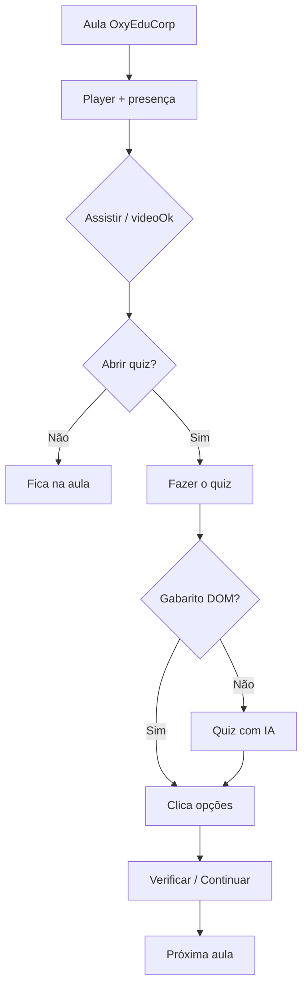

<p align="center">
  
</p>

<h1 align="center">OxyCamp Auto QA</h1>

<p align="center">
  Extensão Chromium para automação e QA na plataforma <strong>OxyEduCorp</strong><br />
  Player, presença, crédito de vídeo, quiz com IA — by <strong>Dvizioon</strong>
</p>

<p align="center">
  
  
  
  <br />
  
  
  
  
</p>

---

## Links

<p align="center">
  <a href="https://github.com/dvizioon/VIZIOON-OXYCAMP">
    
  </a>
  &nbsp;
  <a href="https://oxyeducorp.oxygeni.com.br/">
    
  </a>
</p>

- Repositório: [github.com/dvizioon/VIZIOON-OXYCAMP](https://github.com/dvizioon/VIZIOON-OXYCAMP)
- Plataforma: [oxyeducorp.oxygeni.com.br](https://oxyeducorp.oxygeni.com.br/)
- Pasta da extensão: `extension/` (Load unpacked)

---

## Funcionalidades

- **Player:** retoma play, anti-blur, presença automática e seek liberado no `app-player-travado`.
- **Assistir:** crédito de vídeo via ping incremental (`+10s` / `+1 min` / `+10 min` / minutos custom) com barra de progresso no popup.
- **Aulas:** avançar módulos; **Abrir quiz** liga o fluxo automático vídeo → quiz → próxima aula.
- **Quiz:** gabarito no DOM quando existir; senão **Quiz com IA** (múltipla, V/F, marcar, completar).
- **Provedores:** OpenRouter, Gemini, Groq (API key) e ChatGPT (aba `chatgpt.com` logada, sem key).
- **Teste de IA:** pergunta livre no popup usa o provedor/modelo selecionado.
- **Vídeo:** lê o ID do YouTube da aula e helpers para abrir / baixar.
- **Logs:** painel na extensão com eventos da sessão.

## Como funciona (resumo)

| Toggle | O que faz |
|--------|-----------|
| **Ativo** | Liga/desliga a automação |
| **Liberar seek** | Remove a trava “só pode rever o que já assistiu” |
| **Presença / Anti-blur / Retomar play** | Mantém a aula “viva” no cliente |
| **Avançar aulas** | Permite ir para a próxima `li` da lista |
| **Abrir quiz** | Off = fica na aula; On = abre quiz e só depois avança |
| **Quiz com IA** | Responde o quiz aberto (mesmo com Abrir quiz off) |

Com **Abrir quiz** ligado: vídeo ok → **Fazer o quiz** → IA/gabarito → Verificar → Continuar → próxima aula.  
Com **Abrir quiz** desligado: não abre quiz e **não passa** de vídeo sozinho.

## Tecnologias utilizadas

- **Chrome Extension Manifest V3** (service worker ESM)
- **Content scripts** isolados + script **MAIN** (`page/unlock.js`) no player
- **chrome.storage** para keys, modelo e preferências
- **OpenRouter / Gemini / Groq** via `fetch` no background
- **ChatGPT Web** (sessão da aba + fallback DOM)
- **Node** nos testes de segurança (`tests/security/vXX-*.mjs`)

## Plataformas

| Superfície | Status |
|------------|--------|
| Chrome / Edge / Brave (`chrome://extensions`) | Compatível |
| OxyEduCorp (`oxyeducorp.oxygeni.com.br`) | Alvo |
| ChatGPT (`chatgpt.com`) | Opcional (provedor ChatGPT) |
| Firefox | Não suportado (MV3 Chromium) |

## Fluxo



## Estrutura do projeto

```bash
plugin/
│
├── extension/
│   ├── manifest.json          # MV3
│   ├── shared/                # Constantes, providers, paths
│   ├── background/            # Service worker + AI + ChatGPT bridge
│   ├── content/               # DOM, quiz, nav, settings, bridge
│   ├── page/                  # Unlock seek (MAIN world)
│   ├── popup/                 # Ops / IA / Vídeo / Logs
│   └── icons/                 # Logo e favicons
│
├── tests/security/            # Vetores V-01 … V-19
├── docs/                      # Logo + notes/features
├── package.json
└── README.md
```

## Instalação

### Chrome / Edge / Brave

1. Clone:

   ```bash
   git clone https://github.com/dvizioon/VIZIOON-OXYCAMP.git
   cd VIZIOON-OXYCAMP
   ```

2. Abra `chrome://extensions`

3. Ative **Developer mode**

4. **Load unpacked** → selecione a pasta `extension/`

5. Abra uma aula em `oxyeducorp.oxygeni.com.br` e deixe a extensão ligada

6. Depois de cada update: **Reload** na extensão e **F5** na aula

### Configurar IA (opcional)

1. Popup → aba **Ops**: ligue **Quiz com IA** (e **Abrir quiz** se quiser o fluxo automático)
2. Aba **IA**: escolha o provedor
3. Cole a API key (OpenRouter / Gemini / Groq) ou deixe o ChatGPT aberto e logado
4. Escolha o modelo → **Perguntar** para testar

## Scripts

| Comando | Descrição |
|---------|-----------|
| `npm test` | Roda todos os vetores de segurança |
| `node tests/security/v01-….mjs` | Um vetor por vez |

## API da plataforma (referência)

| Método | Rota | Uso |
|--------|------|-----|
| `GET` | `/api/aprender/aulas/{id}` | Dados da aula |
| `POST` | `/api/aprender/aulas/{id}/ping` | Crédito / `videoOk` |
| `POST` | `/api/aprender/aulas/{id}/quiz` | Inicia quiz |
| `POST` | `/api/aprender/tentativas/{id}/questao` | Questão |
| `POST` | `/api/aprender/tentativas/{id}/responder` | Resposta |
| `POST` | `/api/aprender/tentativas/{id}/finalizar` | Finaliza |

O progresso real depende do **ping** no servidor. Controles só no cliente (seek, blur, presença) não substituem o crédito validado.

## Contato

Dúvidas: [danielmartinsjob@gmail.com](mailto:danielmartinsjob@gmail.com)

**OxyCamp Auto QA** — by **Dvizioon**.
